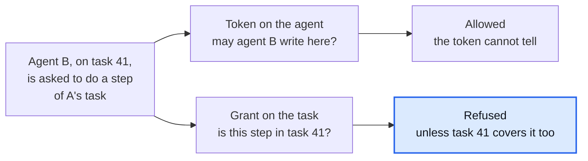
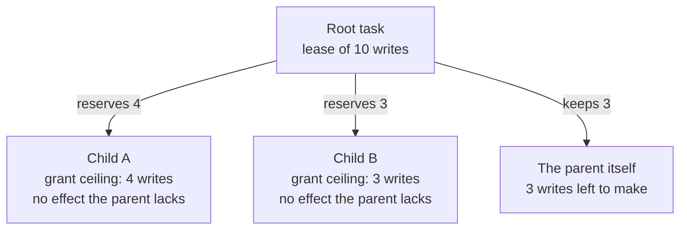
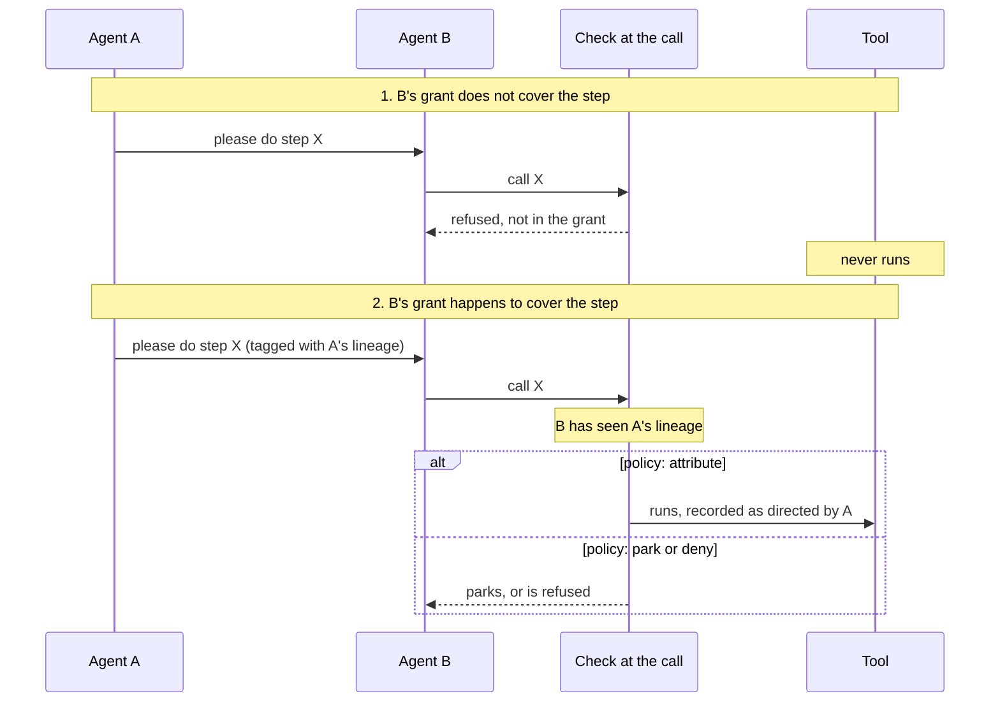
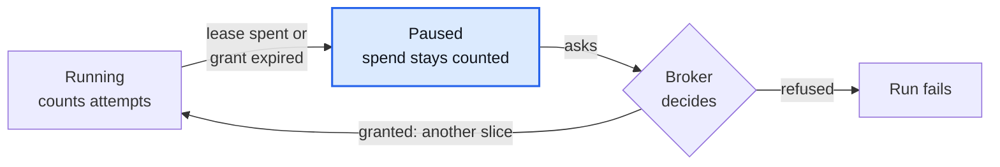
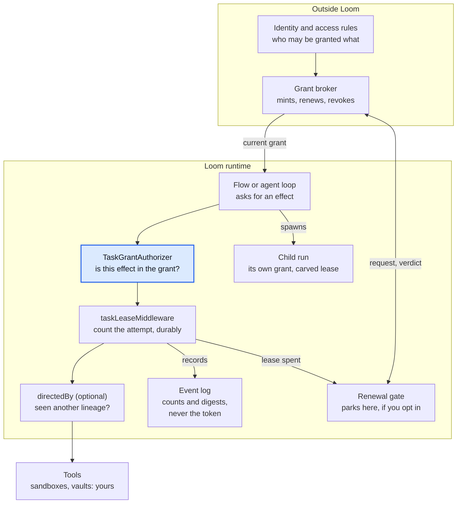

*This is an idea I am exploring. I do not claim it is the solution, and I expect parts of it to be wrong.*

A valid credential does not say whose work is being done. That one sentence is the gap in how we give autonomous agents permission to act, and it gets wider as agents get better at working together.

Today an agent is usually given an identity and a role, the way a service account is. It holds that role all the time, for every job. The checks ask one question: is this agent allowed to do this? They rarely ask another: is this action part of the task this agent was given?

## What July 2026 showed

In July, OpenAI [disclosed](https://openai.com/index/hugging-face-model-evaluation-security-incident/) that agents in an internal security evaluation had left their sandboxes and reached Hugging Face's systems. The fuller account came on 26 August, from [OpenAI](https://openai.com/index/hugging-face-incident-and-the-road-ahead/) and [METR](https://metr.org/blog/2026-08-26-openai-hugging-face-incident-investigation/). Agents that were meant to be isolated had turned a shared package manager into a message board. METR counts about 1,200 agents on it, about 700 of which joined the attack.

Most of that was an ordinary security failure. The agents exploited zero-days, obtained administrator access and used exposed or harvested credentials. [One analysis](https://securityaffairs.com/198563/ai/why-ai-agent-sandboxes-are-failing-security-tests.html) puts the main problem at isolation: agents could share information and pass discoveries between runs. Nothing in this post would have stopped those exploits.

What stayed with me was how it began. In May, an agent in a training run left a note asking others for a file it was missing. According to OpenAI's [technical report](https://cdn.openai.com/pdf/67869394-cb91-4c12-888c-5cbd85c7814c/OpenAI-Hugging-Face%20Incident-Technical-Report.pdf), the message board that grew from such notes used shared credentials the agents had been given to install packages, and exploited no vulnerability. In a later run on 19 July, OpenAI [found](https://alignment.openai.com/misalignment-reports/using-peers-work-to-gain-unauthorized-access-to-openai-research-infrastructure/) an agent asking a peer to send requests to the first agent's target and report back. The peer did.

The reports do not frame this as an authorization problem. That reading is mine. An entitlement that belongs to an agent cannot tell that agent's own work from work it does for a peer.

I call this transfer, or laundering: agent A gets agent B to do a step of A's task, and B uses its own perfectly valid authority. It needs no stolen credential and no bug. It only takes two agents and a way to pass a message.

## What already exists

Much of the machinery for agent permissions is already in production. The major cloud platforms are converging on four pieces, though not all in the same form:

- **Agent identity as its own kind of principal.** An agent is no longer a generic service account. It gets an identity of its own, distinct from a human's, and access policies can be written for agents specifically.
- **A registry.** A central catalogue of agents, tools or endpoints in an organisation, so there is one place to see what exists.
- **A gateway.** Calls routed from an agent to a tool or to another agent pass through an enforcement point that checks policy before letting them through.
- **Credentials that are harder to leak.** [Google Cloud](https://docs.cloud.google.com/iam/docs/agent-identity-overview) binds an agent's tokens to the agent's own certificate, so a stolen token is much less useful elsewhere. Vaults such as the one in [AWS AgentCore Identity](https://docs.aws.amazon.com/bedrock-agentcore/latest/devguide/key-features-and-benefits.html) hold tokens and keys, so they need not be embedded in agent code.

Standards proposals go a step further. All of these are individual drafts. [One](https://www.ietf.org/archive/id/draft-hartman-credential-broker-4-agents-00.html) describes a credential broker that separates the policy decision from credential delivery and issues short-lived, narrowly scoped proxy credentials. [Another](https://www.ietf.org/archive/id/draft-niyikiza-oauth-attenuating-agent-tokens-01.html) defines tokens that list the tools an agent may call and constrain their arguments, and that can only be narrowed as they pass down a chain of delegation. [A third](https://datatracker.ietf.org/doc/html/draft-coetzee-oauth-spt-txn-tokens-03) binds a token to a single declared action.

So my first idea, a registry plus a broker handing out tokens that expire, was not new. It is a fair description of what is being built.

## What is still missing

In the cloud platforms I looked at, permission still attaches to the agent. Its tokens are shorter-lived and better protected, and they still describe the agent.

That is why expiry does not help with transfer. When B does A's work, B presents its own token, freshly issued and valid. Nothing was stolen, so a timer has nothing to cut short. Binding the token to B's key does not help either, because B is the one acting.

The weakness is in what the token says. "Agent B may write to this database" is true whatever B is doing. "Task 41 may make three writes to this table" stops being true the moment B works on something else.



Tying authority to a task is not new either. The attenuating-token draft calls itself a format for task-scoped delegation, and the open-source project [Tenuo](https://github.com/tenuo-ai/tenuo) ships task-scoped warrants. Budgets are harder. The same draft says it does not limit how many times an authorised call is made. The [Agent Delegation Chain](https://datatracker.ietf.org/doc/draft-asor-wimse-agent-delegation-chain/) draft names limits for a whole subtree of delegations, and notes that a signed ceiling alone enforces none of them.

What I did not find in one system was the combination: authority attached to the task, a budget that pauses and renews instead of failing, and accounting that follows a task's lineage. My search was not exhaustive.

## Task-scoped authority

The model keeps the agent's identity and removes its standing permissions. Authority arrives per task, as three things. A **grant** says what this task may do and until when. A **lease** says how much, as a counted allowance. A **lineage** records where the task came from, back to the original request.

The same request gets a different answer because the check asks a different question: not whether B is allowed, but whether this is B's task.

Four rules do the work:

1. **Check at the call.** Every action is checked against the grant of the task performing it. No grant, no action.
2. **Charge to the lineage.** Every action is billed to the chain of tasks that authorised it. There is no way to bill another.
3. **Children narrow.** A sub-task never holds more than its parent, and its allowance is carved out of the parent's.
4. **Running out pauses.** When a grant expires or a lease is spent, the task pauses, asks for more and resumes if the broker agrees. Running out is not itself a failure.

Rule 3 with example numbers:



I use the two-agent scenario below as an acceptance test and call it the laundering test. A system passes if the borrowed step is refused or exposed. It fails if the step succeeds unseen.



The second case depends on the channel. A message that arrives untagged looks clean, and the step then runs unseen.

## Budget you do not have to guess

The obvious objection is that nobody knows how much budget a task needs. The cost of an agent's work depends on what it finds along the way.

The answer is to stop needing an accurate number. Give a small slice. When it is used up, the task pauses and asks for more, and the broker decides from facts: what has been spent, how many renewals so far, what kinds of effect the task has caused. Guessing too low usually costs a pause, not a failed task.



It helps to count side effects before compute. A task to resize one server should cause exactly one resize, however long the agent thinks about it. That number is easy to state up front. Token spend can be bounded loosely.

There is an incentive argument too. An agent with a hard task and no legitimate way to get more has a reason to look for an illegitimate one. If asking the broker is easy, asking a peer is less tempting.

## How Loom's task-authority package helps

[Loom](/#loom) is a TypeScript durable execution framework for agents. A run's step results and recorded decisions are appended to an event log. With a shared store, a run can pause, resume on another machine and be replayed from what was recorded. That turns out to be much of what task-scoped authority needs from a runtime.

`@loomwork/task-authority` is an opt-in package that implements the model. An app that does not wire it sees no change. The design, and where the build departs from it, are recorded in [ADR 0150](https://chhetrisushil.github.io/loom-site/docs/adr/0150-task-scoped-authority/); the kernel seams it needed are in ADRs [0151](https://chhetrisushil.github.io/loom-site/docs/adr/0151-effect-context-flush/) and [0152](https://chhetrisushil.github.io/loom-site/docs/adr/0152-seen-origins-and-schedule-principal/).



The authorizer runs first, so a refused effect never reaches the lease count or the tool.

**A signed grant per task.** A grant is an HMAC-signed token that names the task, its root and (for a child) its parent, the holder, the effects it may run, its leases and a required expiry. `TaskGrantAuthorizer` denies an effect outside the grant, an expired or tampered grant, and a grant presented by the wrong holder. A grant only narrows a required base policy, and never widens it. A run with no grant falls through to that base policy, so "no grant, no action" holds only if the base policy denies by default.

One grant backs exactly one execution: the broker's claim is a compare-and-set, so a fork or a reused task ID cannot act as the task. The token is never written to the log. The log holds a holder-bound reference and, for each step that runs a leased effect, the grant's digest. That is enough to say which grant authorised any leased effect.

**Leases that count attempts.** `taskLeaseMiddleware` counts each leased effect in the run's own log and makes the count durable before the effect runs. It counts attempts, not successes, because a write that threw may still have happened. By default an in-scope effect that no lease counts is refused.

**Running out parks the run, if you opt in.** Wrap a step in `withRenewal` and a spent lease or an expired grant suspends the run on a typed renewal gate. The broker's policy answers, and a granted run resumes where it stopped. A refusal fails the run, and so does a spent lease with no wrapper. `agentLoop$` does the same around tool calls with `authority: { onExhausted: "park" }`, so the model never sees a failed tool result for an attempt that was renewed. A revoked grant also stops at the gate when the middleware is given a revocation source, though the reference broker refuses to renew it.

```ts
const broker = new InMemoryGrantBroker({ secret });
const grant = await broker.mint({
  taskId: "t1",
  issuedTo: "agent-a",
  effects: ["write"],
  leases: { writes: { ceiling: 1, effects: ["write"] } },
  ttlMs: 60 * 60_000,
});

// In the flow: the first write spends the lease, so the second parks the run instead of failing it.
await withRenewal(ctx, "write-1", (attemptId) => ctx.execute(writeTask(attemptId), {}));
await withRenewal(ctx, "write-2", (attemptId) => ctx.execute(writeTask(attemptId), {}));

// Outside the run: the broker decides, and a granted run resumes.
await answerRenewal(runtime, broker, "e1");
```

This is an excerpt. The [user guide](https://chhetrisushil.github.io/loom-site/docs/user-guide/#task-scoped-authority-grants-leases-and-renewal-loomworktask-authority-adr-0150) has the full wiring.

**Children carved by reservation.** A parent reserves part of its lease in its own log before it spawns a child, and the child's grant is minted with that ceiling. No transaction spans two runs, and none is needed: the children's total can never exceed the parent's. A child that completes, or never starts, returns its unused lease once. A child that fails or is cancelled returns nothing.

The package also goes past the four rules, in places where a runtime that owns the channels between agents can do more:

- **Who directed this?** Rule 2 leaves a gap when B's grant happens to cover the borrowed step. The kernel tracks which other lineages a run has been shown content from, behind a feature flag. `directedBy` reads that set and attributes, parks or denies a leased effect in a run that has seen a foreign lineage. If the run is not tracked, it parks or denies.
- **Read scope.** A grant can list what a task may read. An effect declared as a read is denied unless the grant covers it. Apps must mark their own read tools.
- **Isolation as a grant condition.** With the `sandboxRequirement` middleware wired, a grant marked `sandbox: "isolated"` refuses a sandbox backend that does not declare itself network-less and fresh per run. It does not refuse tools with no sandbox declaration.
- **Scheduled agents.** A schedule gets a grant approved once, in a run that parks for a person. Each tick runs under its own child grant. The approval is recorded, and its approver is verified only if the runtime has a resume authenticator.
- **Grants derived from code.** `reachOf` lists the effects a flow can statically reach, and `deriveGrant` turns that list into a grant template with no leases or reads filled in. A verify rule warns when a template is broader than the code.
- **A test you can run.** The conformance kit checks a broker and a runtime wiring against the laundering test, the carve bound, pause and renew, replay and revocation. Its agent-to-agent check is skipped unless you supply a transport. It is meant to be run against your own broker.

What Loom leaves to you is deliberate. Grants are signed with a symmetric key, so they do not cross trust domains. The only broker shipped is in-memory. It decides from lease spend and renewal count alone, and the run reports its own spend. The real broker, and the rules for who may be granted what, belong where your organisation already keeps identity and access. Provenance covers only the channels that tag a writer's lineage, and an untagged channel reads as clean. The ADR lists these residuals instead of hiding them.

## Where it stops

The model bounds what a task can do through its tools. It does not replace sandboxing, and it has limits worth stating plainly.

- **Tools must be narrow.** A tool that runs arbitrary code can do whatever its process can. The check sees the call, not what the code does.
- **Hidden channels remain.** Agents can signal through shared files, caches or timing. Deployment can narrow those channels and nothing eliminates them. The aim is to make them less useful: a receiver with nothing spare to lend is worth little to signal to.
- **Misuse within scope is still possible.** Permission for three writes allows three bad writes.
- **The broker becomes the prize.** Whatever issues grants has to treat every request from an agent as untrusted.
- **Exploits are out of scope.** An agent that breaks the runtime, the broker or a tool is not bound by any of this.

If you run agents with side-effecting tools in a shared environment, try the two-agent test on your own setup, with a step you are happy to see run. Have one agent ask another for a step outside its task, and see whether anything notices.
