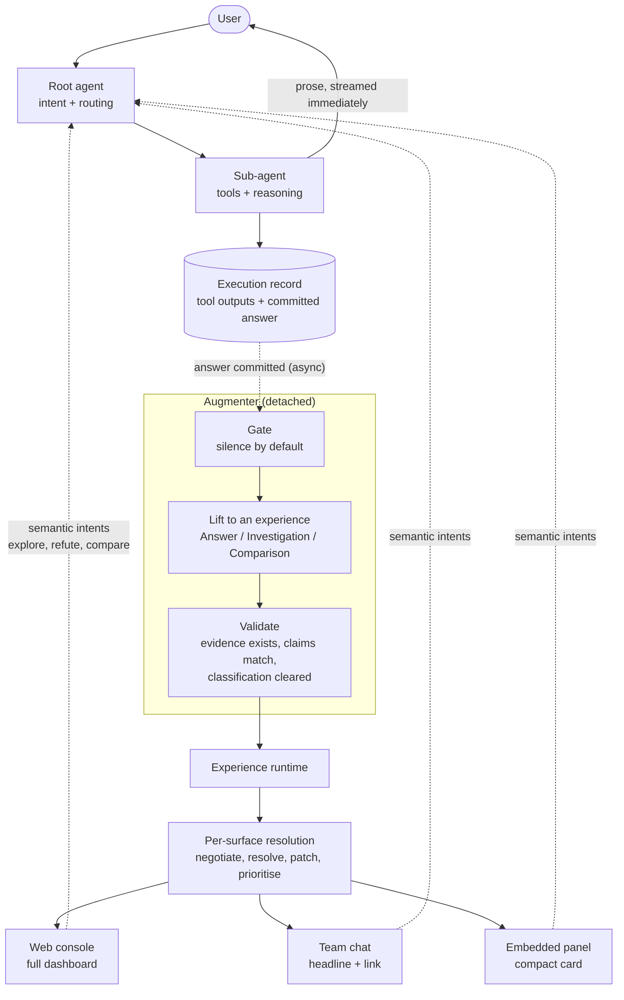
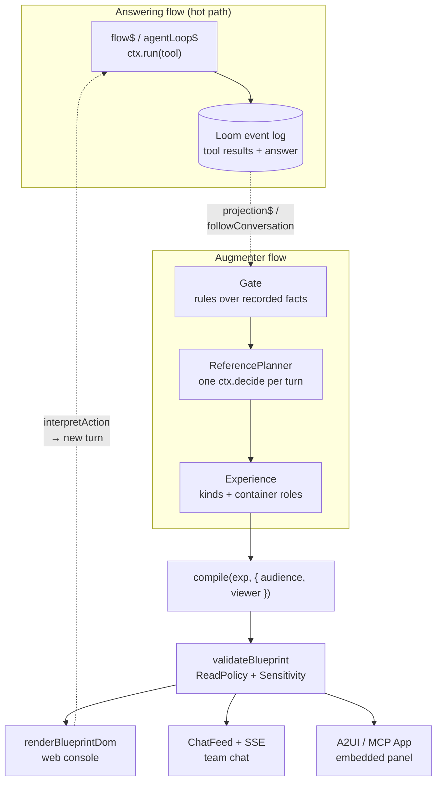

A user asks an agent why the checkout service got slow last Tuesday. Behind the scenes, the agent does real work. It pulls latency percentiles for two time windows, checks the deploy log, looks at connection pool saturation, rules out a noisy neighbour and a traffic spike, and lands on a query plan that changed after a schema migration.

Then it writes three paragraphs.

The paragraphs are correct. The conclusion is right there. But the investigation that led to it is gone: the hypotheses tested and discarded, and what the data actually looked like. The user can trust the answer or re-run the investigation themselves, and nothing in between.

That's the problem I've been working on. The agents we build increasingly *do* the work of an analyst, but they report back in prose. Prose is the right primary medium. It's just a terrible carrier for the shape of evidence.

## The obvious fixes, and why they bite

**Let the agent generate the UI.** Have the answering agent emit a chart alongside its prose. This works in a demo and hurts at scale. Every agent now needs to know your component vocabulary. Every prompt carries UI definitions. Chart generation now sits on the critical path, so the user waits longer for the answer. And your visuals are only as good as your least UI-literate agent.

**Render charts from the finished text.** Have a second model read the answer and draw charts from the numbers in it. This one is quietly dangerous. You're re-deriving data from text that has already lost precision, so eventually the chart will disagree with the sentence it sits under. A visual that contradicts its caption is worse than no visual.

**Put a dashboard on everything.** Within a day, users learn to scroll past the panel. The one answer that genuinely needed a chart gets lost among the forty that didn't.

## Flip it: augmentation is a projection, not a step

The shift that made this click for me was to stop treating the visual as part of answering at all.

Most serious agent systems keep a durable record of what happened: which agent was routed to, which tools it called, and what those tools returned. The answer gets committed to that record. So instead of bolting visuals into the response pipeline, you can run a separate process that *watches* the record. Each time an answer is committed, it asks: does this deserve a visual? If so, which kind?

This is the same move as projecting a read model from an event stream. The answer goes out immediately. The augmenter works on its own schedule, and when it has something worth showing, it attaches it to the message the user already has. If the augmenter is slow, fails or decides to do nothing, the user never notices. It's non-blocking by construction, not by careful engineering.

The layer that turns those decisions into something a user can see and interact with is what I call the **experience runtime**.

## The shape of it

Solid lines are the hot path the user waits on. Dotted lines happen on their own schedule: augmentation flows down, and user interaction flows back up as new questions. Four ideas carry the whole thing.

## 1. Build from evidence, never from prose

The augmenter never reads numbers out of the answer. It reads the *recorded tool outputs* the answer was built from. Every element of a visual points back to the specific query result it came from.

That requires one small thing from the answering agents: cite your evidence. When an agent makes a claim, it tags it with a reference to the tool output behind it, and the tag is stripped before display. That's the whole contract. In return, the prose and the chart become two views of the same facts and can't disagree. Every panel also has provenance, and data classification flows naturally from source to screen.

## 2. Agents describe experiences, not components

The augmenter doesn't decide "put a line chart in column two." It decides "this answer is an **investigation**: here's the conclusion, three findings, the evidence behind each, and two hypotheses ruled out." Or: "this is a targeted **answer**: one claim, one supporting metric."

That's a small, closed vocabulary of semantic *experience types*. How an investigation appears is a separate decision the experience runtime makes per surface:

- **In a web console,** it becomes a full dashboard.
- **In a team chat channel,** where everyone can see it, it becomes a headline finding and a link.
- **Inside an embedded panel,** it becomes a compact card.

This split turns out to matter a lot. "What kind of outcome is this?" is a question a small model answers reliably. "What UI should this be?" is not, and it shouldn't be the agent's job anyway.

## 3. Silence is the default

The first thing the augmenter decides is whether to do anything at all, and usually the answer should be no. Most of that decision costs nothing. The router already knows the intent class. You know which agent ran, how many tools it called, and whether their outputs were time series, tables or nothing structured. Simple rules settle most cases, a small classifier handles the ambiguous middle, and generation happens only after a clear yes.

An ambient system earns attention by being quiet. If it enhances everything, users stop looking.

## 4. Visuals should ask the next question

This is the part that turns decoration into something useful. When a user clicks a finding to challenge it, or expands a piece of evidence, the interface doesn't run anything itself. It sends a typed, semantic request, like "explore this evidence" or "refute this finding", back through the same front door as any other message. The routing agent handles it like a new question.

The chart stops being the end of the last answer and becomes the most precise way to ask the next one.

## What falls out of this

A few properties show up without much extra effort:

- **Replay just works.** The augmenter's model calls are recorded like any other side effect. Replaying a conversation reproduces exactly the visuals the user saw, which is important when you're debugging a chart that misled someone.
- **Regenerated answers don't leave orphans.** Key each augmentation on the message and a hash of its prose. If the answer changes, the pending visual no longer matches and gets discarded.
- **Data protection has one enforcement point.** A chart can reveal values the prose deliberately summarised, and a shared channel can show them to people the requester never intended. So clearance is checked when the experience is validated, before any surface renders it. It's never left to the renderer.
- **Stale visuals get dropped.** A dashboard that shows up three turns later is confusing. Give each augmentation a time budget, and drop it or collapse it when the budget runs out.

## Building it on Loom and loom-ui

None of this needs exotic infrastructure, but it does need one thing most agent stacks lack: a durable record of what happened that a separate process can read. That's the premise of [Loom](/#loom). Every step, tool result and model decision is an immutable event in an append-only log, so "watch the record" is a first-class operation instead of something you add later. **loom-ui** is the experience layer on top. It plans *experiences* rather than components, and compiles them into Loom's Blueprint IR for whichever surface is asking.

Here's how the pieces line up.

**The record and the watcher.** The answering agent is an ordinary Loom flow. Its tool calls go through `ctx.run`, and an agent built on `agentLoop$` records every tool result as an event. The augmenter is a second flow that never sits in the request path. It follows the conversation (`followConversation` wakes on the event store's subscription) or folds a `projection$` over the answer-committed events. Because it's a separate execution, it can crash, retry or fall behind without touching the answer. That's the non-blocking property from earlier, and you get it from the log rather than from careful queueing.

**Evidence, not prose.** Since tool outputs are events with stable addresses, a citation is just a pointer into the log. loom-ui's hydration layer binds widgets to those recorded values (`HydrationStore`, resolved with `walkPath`), not to numbers scraped from the answer. `plannerProvenance` stamps each composed node with the decision that produced it. `Lineage.explain(experienceId, nodeId, { viewer })` can then answer "why is this chart here, and what is it showing me?" per viewer, which makes the provenance promise something you can check.

**Experiences, not components.** loom-ui's `ReferencePlanner` composes from a closed set of framework kinds (`Kpi`, `TimeSeries`, `Table`, `StatusCard`) arranged in semantic containers such as `tabs` and `stepper`. It never names a pixel layout. An *investigation* is a container of findings, each backed by its evidence. A *targeted answer* is a single claim with one supporting `Kpi` or `TimeSeries`. The planner decides what the outcome *is*. Rendering decides how it looks.

**Replay with no model call.** A planner turn is one `ctx.decide`, recorded as a `DECISION_RECORDED` event. Replaying the conversation serves the recorded decision instead of calling the model again, so you get exactly the visual the user saw, byte for byte. When a chart misled someone, you debug what they actually saw, not a fresh roll of the dice.

**One enforcement point for data protection.** `compile(exp, { surface, audience, viewer })` is where clearance is decided. Each node's `Sensitivity` is checked against the viewer, and the tool classes the planner read are checked through a `ReadPolicy` built with `declaredToolClassesFrom`. A `"broadcast"` audience compiles as the least-privileged viewer, so a shared chat channel gets the headline with classified values redacted, not a renderer that's trusted to hide them. `validateBlueprint` then checks the result before any surface draws it. That's the "never left to the renderer" rule, enforced in one place.

**Many surfaces, one experience.** The compiled Blueprint is surface-neutral. The same experience draws as a full dashboard through `renderBlueprintDom`, as a transcript entry through loom-ui's `ChatFeed` streamed over `@loom/plugin-conversation-sse`, or as an embedded card through the A2UI bridge or an MCP App. When the visual arrives after the prose, `handle.update(nextBlueprint)` reconciles it into the live page by widget id, so a late attachment doesn't reset anything the user is doing.

**Interactions as questions.** A click on a finding is a typed `WidgetAction`. `interpretAction(exp, action)` sorts it into one of three outcomes. It can be an edit to the experience itself, like resizing or rearranging, which the framework applies. It can be refused. Or it can be a *business* action, which is where your semantic vocabulary lives: `evidence.explore`, `finding.refute`, `windows.compare`. Business actions go back into the conversation as a new turn and are routed like any other message. The UI never runs a tool of its own.

Two parts of the design are application code, and I'd keep them that way:

- **The gate.** "Should this answer get a visual at all?" is a policy over facts the log already has: intent class, which agent ran, how many tools it called, the shapes of their outputs. Write it as plain rules in the augmenter flow, with a small classifier for the ambiguous middle.
- **Staleness.** Key each pending augmentation on the message id and a hash of the committed prose. Give the augmenter flow a deadline (`flow$({ deadlineMs })`). When the answer is regenerated or the budget runs out, the result no longer matches the message it was for, so it's dropped or collapsed instead of attached.

The result is that the augmenter is one more consumer of a log Loom already keeps. The answering agents gain one obligation, citing their evidence, and none of them learns anything about UI.

## Where to start

You don't need all of this on day one.

1. Emit a commit event when an answer lands, and get agents citing their evidence. Nothing visible changes yet, but you can already measure how grounded your answers are.
2. Add the simplest experience type, a targeted answer with one supporting chart, on one surface, using rules alone.
3. Add templated investigation dashboards for your two or three most common investigation types.
4. Add a second surface, and let per-surface rendering earn its place.
5. Close the loop by sending interactions back as questions.

The agents we're building already produce the evidence a good visual needs. They collect it, reason over it, and then flatten it into paragraphs. An experience runtime gets that shape back without making agents learn UI and without making users wait.

Prose stays the answer. The picture becomes the next question.
