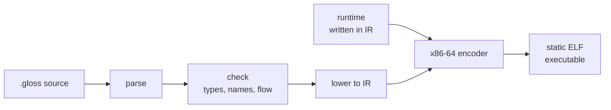

> **A note before anything else: Gloss is a fun project.** It is something I build in my spare time because I enjoy it, not a product, not a startup, and not a recommendation to use it for anything that matters. It runs on one platform (x86-64 Linux), it is unfinished, and the repository is not public yet. Read this as a write-up of a hobby, not an announcement.

Agents now write most of the code I see, and I read less of it than I used to. That bothers me a little. Not because the code is bad, but because I can feel myself drifting away from what programs actually do: the loops, the arithmetic, the bytes going to a file.

So, for fun, I started building a small programming language whose main job is to be *read*. It is called **Gloss**. It reads like plain sentences, and it compiles straight to a native executable, with no other compiler or library underneath.

## What it looks like

Here is FizzBuzz:

```gloss
feature start
  for each i from 1 to 15
    if remainder of i by 15 is 0
      show "FizzBuzz"
    otherwise if remainder of i by 3 is 0
      show "Fizz"
    otherwise if remainder of i by 5 is 0
      show "Buzz"
    otherwise
      show i
```

And a greatest common divisor, with a feature that calls itself:

```gloss
feature gcd
  needs a as number, b as number
  if b is 0
    give a
  give gcd with b, remainder of a by b

feature start
  show "gcd of 48 and 36 is ", (gcd with 48, 36)
```

`gloss build gcd.gloss` checks the program and writes a static executable called `gcd`. Running it prints `gcd of 48 and 36 is 12`.

Gloss is meant for small command-line programs that work on records and tables kept in files. That is deliberately narrow: an expense list, a reading log, a list of chores. These are the kind of programs an agent might write for someone who has never programmed, and which that person should still be able to read, check and change.

## The rules it follows

The whole language hangs off six design rules. Every construct has to obey all of them:

1. **Structured like code, worded like English.** Every statement starts with a fixed keyword, so nobody has to guess a phrasing.
2. **One form per idea.** No synonyms, no optional words. If you write `set t to t + 1`, the formatter rewrites it to `add 1 to t`, because that is the one way to say it.
3. **No grammar words.** No articles, pronouns or plurals. `for each expense in expenses` works because `expenses` is just a name, not an English plural.
4. **Symbols for arithmetic, words for everything else.** `+ - * /` compute; `is`, `and`, `not` compare and combine.
5. **The compiler infers but never guesses.** If a line could be read two ways, it is an error that asks for parentheses. `whole of a / b` is refused, and the message spells out both readings.
6. **Nothing hidden.** A program does only what its source says, and file access is approved when you build.

Rule 2 turned out to be the most fun to live with. It means the error messages can be very specific, because there is only ever one right answer to suggest:

```text
line 2: set total as 0. set needs to. Did you mean set total to 0?
```

The messages are part of the language design. The tests check every one of them word for word.

## Tables and files

The biggest part so far is tables. A record describes a row, and a table ties a list of records to a CSV file:

```gloss
record Expense
  name as text
  amount as number
  category as text

table expenses of Expense in "expenses.csv"
```

Nothing touches the disk unless a line says so: `load expenses`, `save expenses`, `clear expenses`. Because these programs will mostly be written by agents and run by people who did not write them, I put more care into this corner than a hobby strictly needs:

- **A program can touch only the files named in its table lines.** No statement opens any other file, uses the network or runs another program.
- **Every file is approved at build time.** Each build prints what the program can do, and each file needs an approval, which is kept in a plain `.allow` file next to the source. New access needs a new approval. The executable carries the same list and prints it with `--permissions`:

  ```text
  This program can:
    read and replace   expenses.csv
    read only          rates.csv
    nothing else
  ```
- **Symbolic links are refused.** Files are opened with Linux's `openat2` and `RESOLVE_BENEATH | RESOLVE_NO_SYMLINKS`, so a link cannot point a table at some other file on the machine.
- **Saving is crash-safe.** `save` writes `expenses.csv.gloss-new`, flushes it to disk, renames it over the old file and flushes the folder. A crash part-way leaves the old file intact.
- **You cannot wipe a file by accident.** Saving a table you never loaded or cleared is a compile error where the compiler can see it, and a run-time stop where it cannot.
- **Bad data gets a plain message.** A cell that is not a number stops the program with the file and line: `expenses.csv line 7: amount "12,50" is not a number`.

## No dependencies, on purpose

The compiler is written in Rust and uses only the standard library. There is no LLVM, no assembler and no linker. Gloss does every step itself:



Even the runtime is written in the compiler's own intermediate representation: printing numbers, growing lists, parsing CSV, checking UTF-8. The same backend lowers it as the user's program, so "nothing hidden" holds all the way down. `gloss explain` prints each source line beside the machine instructions it became, runtime routines included.

That choice makes testing interesting. Next to the real backend there is a small interpreter for the IR that exists only in the tests. Every test program runs twice, once as a real Linux executable and once in the interpreter, and the two must agree on output, errors and exit status. When they disagree, one of them has a bug, and finding which has caught quite a few real ones. The file tests go further: the interpreter models the file system, and the test suite compares what each run leaves on disk, down to which files were flushed and in what order.

## One program, every command

Here is one small program taken through every command. The outputs below are copied from real runs on x86-64 Linux, not written by hand.

The program adds up spending by category from a CSV file, and has one test:

```gloss
record Expense
  name as text
  amount as number
  category as text

table expenses of Expense in "expenses.csv"

feature category_total
  needs wanted as text
  set total to 0
  for each expense in expenses
    if category of expense is wanted
      add amount of expense to total
  give total

feature start
  load expenses
  show "Food: ", (category_total with "food")

test "only the wanted category counts"
  append Expense with name "Lunch", amount 120, category "food" to expenses
  append Expense with name "Bus", amount 40, category "travel" to expenses
  expect category_total with "food" is 120
```

```text
name,amount,category
Lunch,120,food
Bus,40,travel
Dinner,300.50,food
```

**Build.** `gloss build` checks the program, prints what it can touch, and writes a static executable. Each file needs an approval; in a terminal the build asks, and `--allow` gives it up front. The approval is kept in `expenses.allow`, so the next build asks nothing.

```text
$ gloss build expenses.gloss --allow expenses.csv
This program can:
  read only          expenses.csv
  nothing else
Approval saved in expenses.allow
Built expenses
```

**Run.** The executable is the program and nothing else. It also carries its permission list:

```text
$ ./expenses
Food: 420.5
$ ./expenses --permissions
This program can:
  read only          expenses.csv
  nothing else
```

**Test.** Test blocks live in the program. A test starts with empty tables, so it never touches the real file:

```text
$ gloss test expenses.gloss
pass  only the wanted category counts

1 passed, 0 failed
```

**Format.** There is one accepted way to write each line. Take this program, which works but is written loosely:

```gloss
feature start
  set total to 0
  set prices to list of 120,40,   300.50
  for each price in prices
    set total to total+price
  show "Total: ",total
```

The build refuses it and names the one right form. `gloss format` rewrites the file into that form:

```text
$ gloss build messy.gloss
line 5: set total to total+price. set with + on its own target is written with add. Did you mean add price to total?
$ gloss format messy.gloss
Formatted messy.gloss
```

```gloss
feature start
  set total to 0
  set prices to list of 120, 40, 300.5
  for each price in prices
    add price to total
  show "Total: ", total
```

**Trace.** `gloss trace` builds a traced copy, runs it, and narrates each step in plain words, with the program's own output in its place. The same steps go to `expenses.trace` as JSON events.

```text
$ gloss trace expenses.gloss
This program can:
  read only          expenses.csv
  nothing else
line 17: loaded expenses from expenses.csv (3 rows)
line 18: calling category_total with wanted = "food"
  line 10: total is 0
  line 11: expense is Expense with name "Lunch", amount 120, category "food"
  line 12: "food" is "food", so the block runs
  line 13: total becomes 120
  line 11: expense is Expense with name "Bus", amount 40, category "travel"
  line 12: "travel" is "food" is no, so the block is skipped
  line 11: expense is Expense with name "Dinner", amount 300.5, category "food"
  line 12: "food" is "food", so the block runs
  line 13: total becomes 420.5
line 18: category_total gives 420.5
Food: 420.5
```

**Explain.** `gloss explain` prints the real instructions under each source line, with comments naming the variables and the checks. This is the start of `category_total`. The whole output also covers `start` and then every runtime routine the program uses, about 3,700 lines in all:

```text
$ gloss explain expenses.gloss
Explain expenses.gloss for x86-64 Linux

feature category_total (line 8)
  wanted: text, input 1, at [rbp+16]
  total: number, created on line 10, at [rbp-8]
  expense: Expense, loop variable on line 11, at [rbp-16]
…
line 10: set total to 0
    movabs rax, 0
    mov [rbp-8], rax                ; total
line 11: for each expense in expenses
    lea rax, [rip+tables]
    mov rax, [rax+0]
    mov rax, [rax+0]
    mov [rbp-24], rax
    movabs rax, 0
    mov [rbp-32], rax
  .L0:
    mov rax, [rbp-32]
    mov rcx, [rbp-24]
    mov rcx, [rcx+0]
    cmp rax, rcx
    jge .L2
    shl rax, 3
    mov rcx, [rbp-24]
    mov rcx, [rcx+16]
    add rax, rcx
    mov rax, [rax+0]
    mov [rbp-16], rax               ; expense
line 12: if category of expense is wanted
    mov rax, [rbp-16]               ; expense
    mov rax, [rax+16]
    push rax
    mov rax, [rbp+16]               ; wanted
    push rax
    call text_equal
    add rsp, 16
    movabs rcx, 0
    cmp rax, rcx
    je .L4
line 13: add amount of expense to total
    mov rax, [rbp-16]               ; expense
    mov rax, [rax+8]
    mov rcx, rax
    mov rax, [rbp-8]                ; total
    add rax, rcx
    jo .L5                          ; failure 4: a number went out of range (add amount of expense to total)
    mov [rbp-8], rax                ; total
    jmp .L3
…
```

**Flowchart.** `gloss flowchart` writes one SVG chart per feature, drawn by the compiler itself. The boxes are the source lines:

```text
$ gloss flowchart expenses.gloss
Wrote expenses.category_total.svg
Wrote expenses.start.svg
```


## How it is being built

The way the project is run is half the fun. Gloss is built mostly by AI coding agents, and I steer:

- **A spec first.** The language has a written spec, and every implementation decision is recorded with an id and a reason, along with the alternatives that were rejected.
- **A plan per milestone.** Each milestone gets a plan split into small tasks.
- **Small pull requests.** Every change is at most 200 lines and 10 files, merged one at a time.
- **Review before merge.** Every task is reviewed by a separate agent before it goes in, and the reviews keep finding things. Recent catches include:
  - a table comparison that compared memory addresses instead of contents;
  - a CSV reader that treated a trailing blank line as a row;
  - the real executable and the test interpreter disagreeing about an edge case of renaming files.

It is a slightly absurd amount of process for a toy language. It is also the most fun I have had with a side project in a long time, and a good way to learn what agents are good at and where they still need a careful reviewer.

## Where it stands

| Milestone | What it adds | State |
|---|---|---|
| 1 | Lexer, parser, checker, `gloss format` | Done |
| 2 | Code generation: `gloss build` writes an x86-64 Linux executable | Done |
| 3 | Tables and files: CSV `load` and `save`, file permissions | Done |
| 4 | `gloss test`: test blocks inside the program | Done |
| 5 | `gloss trace`: a run narrated in plain words | Done |
| 6 | `gloss explain`: the machine code beside each source line | Done |
| 7 | `gloss flowchart`: an SVG chart of each feature | Done |

Every milestone in the original plan is now done. The last three were the ones I was most looking forward to:

- `gloss trace` narrates a run in plain words.
- `gloss explain` shows the machine code behind each line, the runtime included.
- `gloss flowchart` draws each feature as a diagram, with a box for every statement.

Together they are the point of the whole thing: a program you can read, run, watch and see through.

Once more, because it matters: **this is a fun project.** It may change direction, stall for weeks, or never be finished, and that is fine. If it ever becomes something other people can use, I will write about that too.
