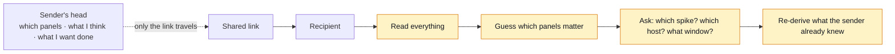
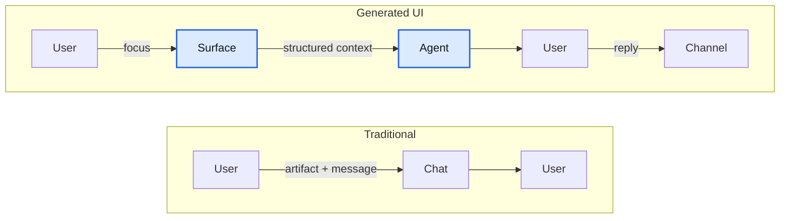
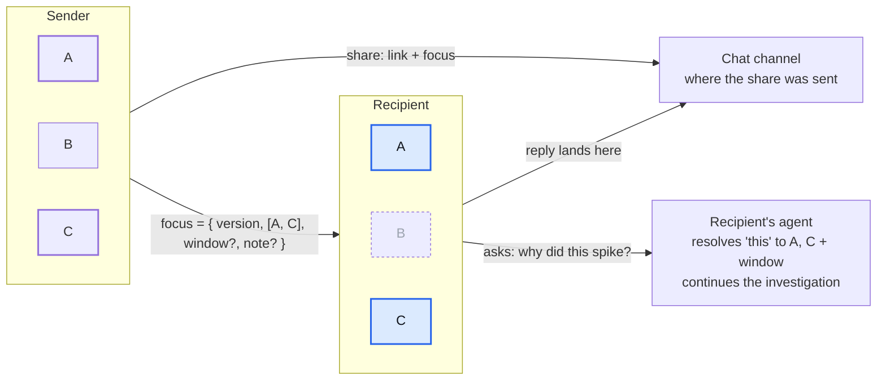
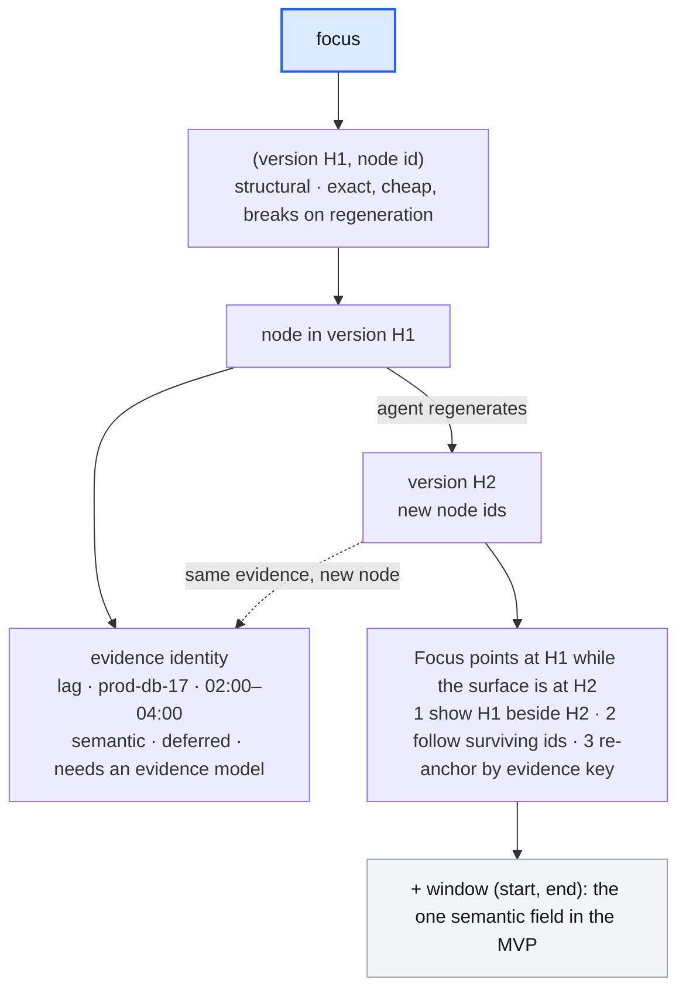
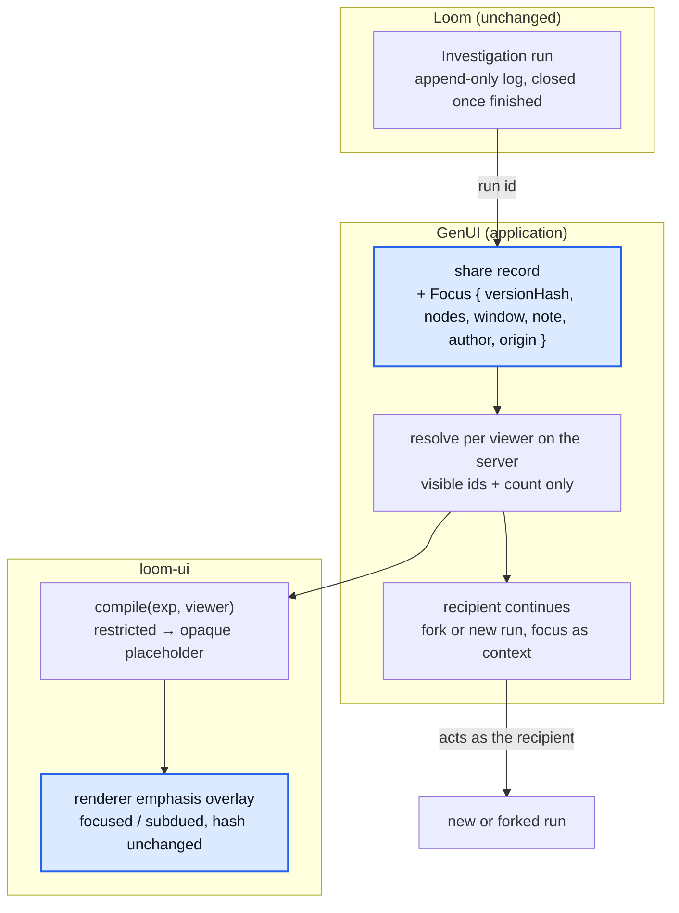

*Illustrative mockup of the flow. Focus handoff is designed, not built; the screenshots below are mockups too.*

Every engineer who has been on call knows this message:

> here's the dashboard, look at the latency panel (third row, not the first one), around 02:15, I think it's the replication lag but not sure

The link is almost incidental. The message is doing the real work: it carries where to look, when to look, and what the sender already thinks. Strip the message and the link is just twelve panels and a mystery.

We have been building GenUI, a system where the interface is not designed ahead of time but generated at runtime around what an agent found. In its "AI Mode", agents investigate your infrastructure, decide what matters, and build a surface to show it. That sharpens the problem above rather than solving it: now the dashboard is bespoke to one investigation, the sender knows exactly why each panel exists, and the recipient knows none of it.

This post is about the small primitive we designed for it, why it is deliberately not a commenting system, and why generated UI on a durable agent runtime is an unusually good place to build it. It is also about the parts of our first design that turned out to be wrong once we checked them against the code. Those corrections taught me more than the design did.

## The problem: a shared artifact loses its intent

A generated interface is a snapshot of what an agent found and what it decided mattered. The person who asked for it carries a second layer the interface does not show: which panels prompted the share, what they think is going on, and what they want the other person to do.

Share the interface and only the first layer travels. The recipient reconstructs the second by reading everything, guessing which panels matter, and asking. The cost lands in three places:



- **Time to comprehension.** Reading panels that don't matter before finding the ones that do.
- **Clarification traffic.** "Which spike?" "Which host?" "What window?"
- **Duplicate investigation.** Re-deriving a conclusion the sender already reached, because it lived in their head.

The obvious fixes each solve a neighbouring problem. A bookmark answers "how do I get back here", not "look at this element". Dashboard comments exist in Grafana and Datadog and are barely used, because the conversation already lives in Slack and nobody wants a second place to talk. The message beside the link is annoying but it works, and people tolerate a lot of annoyance before adopting a new primitive.

So the bar is high. Whatever we build has to be cheaper than typing a sentence, and it has to work *with* the channel people already use rather than compete with it.

## The concept: share attention, not artifacts

The mistake we almost made was to name the solution before the problem. "Add comments" is a solution. The problem is narrower: **the sender's attention does not travel with the share.**

Once you say it that way, the design space shrinks. You don't need threads, intent taxonomies, assignees, or lifecycle states. You need the sender to be able to point, and the pointing to survive the trip.

Generated UI is unusually well placed for this, for reasons a hand-built dashboard can't match:

- **Every element exists for a reason.** The agent put the latency chart there because the investigation touched latency. That reason is recoverable.
- **Elements have stable identity.** A generator that emits a component tree can give every node an id that survives re-rendering. Pixel coordinates and panel titles can't.
- **The interface is a representation, not the thing itself.** The same investigation can render differently for different viewers or surfaces. Anything attached to the rendering alone is lost at the next render; anything attached to the structure underneath is not.
- **An agent sits on both ends.** The sender's agent built the surface; the recipient's agent can read what the sender marked and act on it.

That last one is the part no static tool can do. "Why did this spike?" is unanswerable without knowing what "this" is. If the sender's pointing travels as structured data, the recipient's agent doesn't have to guess.



The thesis in one line: *traditional collaboration shares artifacts and messages; collaboration over generated UI should share attention, and let the agent do the rest.*

## The design: focus handoff

A **focus handoff** is a share that carries three things: the interface, a handful of elements the sender wants looked at, and at most one line of text. On the recipient's side, the marked elements are emphasised and the rest subdued, and the line is shown once, at the top.

That is the whole feature. Concretely, a focus is a small immutable record stored with the share:

```typescript
const Focus = z.object({
  versionHash: z.string(),        // content hash of the surface version the sender saw
  nodes: z.array(z.string()).min(1).max(5),
  window: z.object({ start: z.string().datetime(), end: z.string().datetime() }).optional(),
  note: z.string().max(280).optional(),
  author: z.string(),
  origin: z.object({ surface: z.string(), ref: z.string() }).optional(), // where it was shared
});
```




*Mockup of the sender's side: pick one to five elements and add one line. The time window is captured from the panels.*

Three design decisions matter more than the rest.

**Anchor to structure, not pixels or semantics.** A focus points at `(version hash, node id)`. That is exact and nearly free, because the generator already assigns both. It breaks if the agent regenerates the surface, but for the first version the answer is simply to keep the old version reachable beside the new one. The durable fix is to anchor to the *evidence* a node represents ("replication lag on prod-db-17, 02:00–04:00"). That needs an evidence model most generated-UI systems don't have yet, and we deferred it rather than smuggle it in. The one semantic field we kept is the time window, because it is cheap and it is the thing recipients most often ask about.



**The note is not a thread.** It renders once, attributed, at the top. It cannot be replied to in place. The `origin` field links back to wherever the share was sent, and the reply goes there. The moment a recipient can respond on the element, you have built a chat, and it will lose to the real one.

**Visibility asymmetry is a first-class case.** Generated surfaces are compiled per viewer, and nodes a viewer isn't cleared for become placeholders. The sender can point at a node the recipient will never receive, and a focus mode that highlights nothing fails silently. So the sender is warned before sending ("1 of 2 flagged items is restricted"). The recipient sees "2 flagged, 1 visible to you" rather than nothing, and the missing item is never named. On broadcast surfaces, where the same rendering reaches everyone, a focus may only reference nodes everyone may see.


*Mockup of the share-time clearance check. It names the problem to the sender and promises the recipient will only see a count.*


*Mockup of the recipient's side: emphasis, subdued siblings, the note once at the top, a back-link to the thread, and "2 flagged, 1 visible to you".*

The recipient's agent gets the focus as structured context: the nodes, what components they are, the window, the note, and the run that produced them. It can narrate the handoff and continue the investigation from where the sender left off.


*Mockup: "Why did this spike?" needs no clarification, because the focus carries the node, the window and the run.*

## How Loom and loom-ui keep this small

GenUI runs on Loom, a TypeScript durable agent execution framework, and renders through loom-ui, the UI framework built on top of it. My first draft of this section was a tidy story in which every piece of the feature landed on existing machinery. Then we checked it against the code, and four of those pieces were wrong. The corrected design is still small, and it is smaller in the places that matter. **Loom needs no change at all.**

**Versioned surfaces give the anchor for free.** A loom-ui surface (an *Experience*) is a tree of nodes whose ids are minted once and never reused. Every change is an operation that records a new, immutable, content-addressed version. So `(version hash, node id)` is exact forever for the version the sender saw, and it still resolves in later versions for any node that survives. Planners return operations, not fresh trees, so a revise that moves a flagged node changes its position but not its id. We didn't have to invent an addressing scheme; we only had to write down the one we already had.

**Emphasis is a view-time overlay, not a mutation.** The first draft made `emphasize` one more operation in the mutation vocabulary. But every operation mints a new version, and the version hash covers every node field, so the recipient would no longer be looking at the sender's hash. Emphasis is viewer-local state, like a selected tab. It belongs in the renderer as an option that marks nodes as focused or subdued, styled with the framework's own tokens and never written into the surface. The hash stays the sender's, and clearing the focus is just rendering without the option. This is the one capability loom-ui needs to grow for focus handoff, in both the web and terminal renderers.

**The focus lives with the share, not on the run log.** The first draft appended a `focus.created` event to the investigation's own log. In Loom, though, a finished run is closed to new facts except for a single, narrowly authorised outcome record. Opening it to arbitrary late appends would be a kernel change with exactly one consumer, and Loom's rule is to name a second, unrelated consumer before something becomes kernel surface. So the focus is stored beside GenUI's share record, which already pins the checkpoint it shares, and it references the run by id.



**Continuing the investigation is a fork, not a resume.** The first draft had the recipient resume the *original* run, with "permissions following the recipient". Loom deliberately doesn't work that way: a run's effects always execute as its recorded owner, whoever resumes it. Resuming would quietly lend the recipient the sender's authority, which is exactly the bug a durable principal exists to prevent. The recipient instead forks the run, and a fork acts as the forker, or starts a new run linked to the original. Either way, the focus goes in as input to the agent: the node ids and the window as structured context. The note needs more care, because it is someone else's words. It enters the transcript as a message marked with its origin, which Loom taints as untrusted and fences at the prompt boundary. Interpolating it into the context would launder that taint. Delivered this way, the note can steer what the agent looks at but can never become instructions.

**Clearance is enforced at compile, and a leak got fixed on the way.** loom-ui compiles a surface for a specific viewer and replaces restricted nodes with placeholders. Checking focus against that exposed an existing bug: the placeholder kept the hidden node's original, human-readable id, so an id like `payroll_salary_by_employee` told an uncleared viewer exactly what was hidden. A shared focus carries node ids to a different viewer by design, so it would have made that leak worse. Placeholders now carry an opaque, stable alias instead. That fix has shipped, and it was worth doing whether or not focus handoff ever is. On top of it, the "2 flagged, 1 visible to you" count is a few lines over loom-ui's existing visibility queries. The note is classified at the strictest level of the nodes it flags, because nothing can infer the sensitivity of free text.

**The time window doesn't touch the surface.** loom-ui's hydration controller can re-ask only the data handles whose parameters changed. Applying the sender's window to the flagged panels is a parameter change, not a new version.

**"Show me what the sender saw" is deferred, and the first draft had the mechanism wrong.** I originally wrote that a flagged node could be re-hydrated from the tool results logged during the investigation. GenUI hydration is transient by design and writes nothing to the log. The real record of what a viewer was shown is loom-ui's per-viewer seen log, and reading it back is redacted against the *reader's* clearance. That is the right foundation if we build a sender snapshot later, but it isn't part of the first version.

**Surfaces own what emphasis looks like.** In the web renderer, emphasis is a highlighted border, scroll-into-view on open, subdued siblings, a banner with the note and a back-link, and a toggle to clear. Slack and hosted MCP App views come later. GenUI's Slack blocks and MCP App payload are both being reworked, and Slack first needs node-addressed blocks. When they land, a Slack focus is ordering plus a context line, restricted to nodes everyone in the channel may see. An MCP App view can carry a focus only as a field on its payload.


*Mockup: the share goes through the channel people already use, and the focus records the origin so the surface can link back.*

Put together, the build in dependency order is:

1. Measure first (see below).
2. Wire a viewer into GenUI's compile and hydration, a fix worth having regardless.
3. Store the `Focus` with the share, with the share-time clearance check and per-viewer resolution.
4. Build the recipient view on loom-ui's emphasis overlay, with the window applied as a parameter change.
5. Continue as the recipient through a fork or a new run.
6. Add the Slack and MCP App projections.

Loom changes nothing. loom-ui grows one renderer option, plus the placeholder fix it needed anyway.

## What we deliberately left out

Scope tried to grow in four directions, and each one is a reasonable product that doesn't belong in this one.

- **Not a commenting system.** Threads on elements recreate Google Docs comments on a dashboard, and that pattern has already lost to chat in this domain.
- **Not an intent taxonomy.** Typing focuses as *question*, *hypothesis*, or *action* adds a field the sender must choose and the recipient must interpret. One line of free text covers all three and reads faster.
- **Not a task or approval system.** "Please investigate X" and "approve this remediation" are workflow objects with assignees, states, and audit trails. GenUI already binds an approval to a pair of hashes, the surface version and the report it approves. An approval annotation would be a second approval path.
- **Not an evidence model, yet.** Semantic anchoring is the durable answer and it is a bigger project than the feature it would serve. It deserves to be built for the agent's own sake, so it can cache and reuse evidence across runs, and scoped as that.

The test for any addition: does it help the recipient find what the sender meant, or does it start a conversation? Only the first belongs here.

## What we measure next

The honest caveat: a lab study will show that pointing at things helps, because pointing at things always helps in a lab. What it can't show is whether anyone shares generated investigations often enough for this to matter. So the first step is not a prototype; it is two numbers from existing logs. How often are surfaces shared, and how many words of locating language accompany each share? If shares are rare, we stop. If the accompanying message is routinely a paragraph, we build.

Then the comparison, same metrics with and without focus: clarification rate, accompanying-message length, time from open to first agent query, and duplicate-investigation rate. That last one is the interesting one. Because an agent's durable tool calls are in the Loom run's event log, we can see directly when a recipient's investigation repeats a query the sender's already ran. No dashboard tool can measure that. It is the strongest evidence the feature could produce, and it comes from a log we already keep.

The metric we will not use is the count of focuses created. Volume measures adoption of a control, not reduction of a problem.

---

AI generates the interface. Humans point at the evidence. Agents continue the investigation. The first and third are already true in GenUI. The middle one, once checked against the code, needs a six-field record kept with the share, one render option in loom-ui, and no change to Loom. That's what it looks like when a runtime is designed around durable, addressable state: the collaboration feature is mostly a matter of writing down what the system already knows, and of being honest about what it doesn't.
