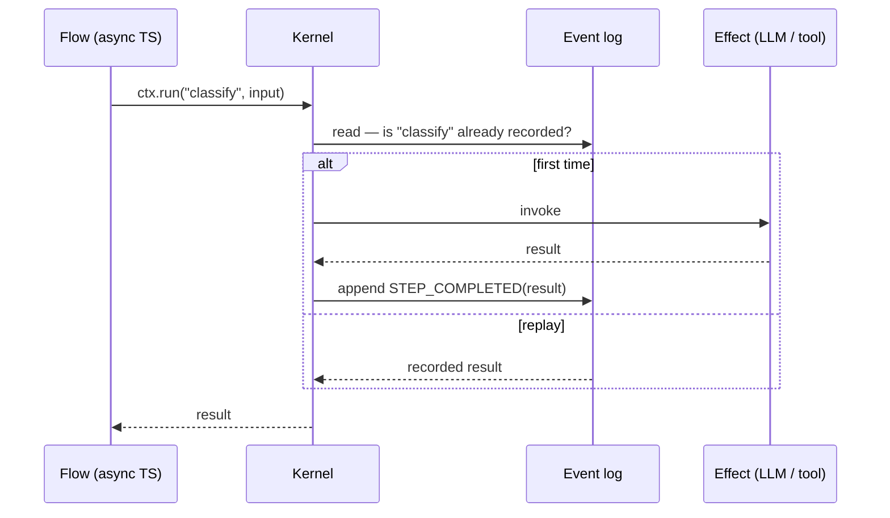
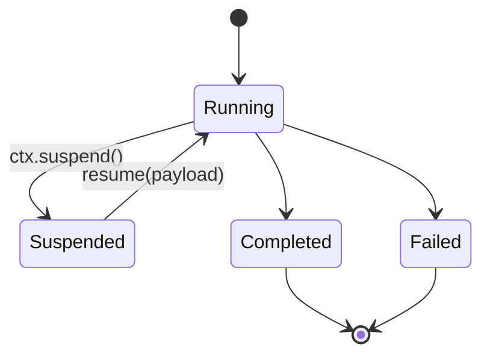

Most agent frameworks keep a workflow's state the way a web request does: a mutable object in
memory, maybe serialised to a database row between steps. That works right up until the process
dies halfway through a step, and then you are left asking a question the row cannot answer —
*what actually happened?*

Loom starts from the other end. Every step, every decision and every external call is written as an
immutable fact to an append-only log. State is never stored; it is **derived**:

```ts
const state = events.reduce(apply, initial);
```

That one line is the whole idea. Everything below is a consequence of it.

## The shape of an execution

An execution is a sequence of facts. The interpreter reads the log, folds it into state, and decides
what to do next. If the next thing is an effect — a model call, a tool, an HTTP request — the
*result* is appended before the flow continues.



The `alt` branch is the important part. On replay the effect is **not** invoked again: the kernel
serves the recorded result from the log. That is what makes a crash boring — restart the process,
re-fold the log, and the flow picks up exactly where it stopped, without sending the same email
twice.

## Pausing for a human

The same property makes human-in-the-loop a one-liner. `ctx.suspend()` appends a checkpoint and
hands control back. Nothing is held in memory while the approval sits in someone's inbox for three
days.



When the approval arrives, it may land on a different machine running a newer build. That machine
reads the log, folds it, and continues. There is no session to migrate because there was never a
session — only facts.

## What you give up

This is not free. Flows have to be deterministic between effects, so anything non-deterministic —
the clock, randomness, a network read — has to go through the kernel to be recorded. And the log
grows, so you need snapshots and retention to keep the fold cheap.

Those are real costs. But they are costs you pay *up front*, in the shape of the API, instead of
at 3 a.m. while reconstructing what a half-finished workflow did from scattered logs. For software
that has to keep working, that is the trade I would make every time.
